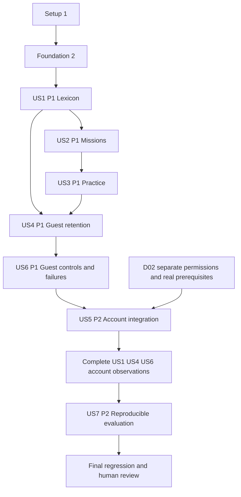

# Tasks: Nordljud CORE Learning and Private Progress

**Tasks version/status**: 0.1.0 FOR HUMAN REVIEW — all implementation checkboxes are intentionally unchecked.
**Generated**: 2026-10-30 Europe/Helsinki by genuine execution of the installed official Spec Kit 0.12.11 `speckit-tasks` skill.
**Branch / starting HEAD**: `condition/spec-driven` / `d140bc9898ef134efff7dc14ef95b2f2158ebc5f`. Existing approved uncommitted Clarify/Plan/Checklist work is preserved; this SHA is not a built/tested application revision.
**Input**: This directory's [specification](spec.md), [Plan](plan.md), [research](research.md), [data model](data-model.md), [quickstart](quickstart.md), all four contracts and [reviewed readiness checklist](checklists/core-readiness.md).
**Template**: The setup script resolved `.specify/templates/tasks-template.md`; its governed phase structure, test/evidence requirements, dependencies, parallel examples and incremental strategy are applied below. Sample tasks are replaced.

## Governance and Current Boundary

Constitution v1.0.0 is ratified. Specification v0.4.0 is bound to raw SHA-256 `7AC546793D8EF63DA8563AB4B3CFF081374EB3ED4CFB98DE052DC0944275B2A1`; its historical draft labels remain unchanged and its later approval is retained in Plan evidence. The seven original Plan v0.1.0 artifacts were approved; revision v0.1.1 records only the subsequently approved G01/G02 policies. The student approved the 33 supported checklist assessments and these two policies, after which the adopted text was re-reviewed: 35/35 documentary items supported. None is a runtime test or approval of this newly generated task list.

[Current authorization and exact approval](../../evidence/sdd-tasks-core-2026-10-30/approval-receipt.json) permits these documentation clarifications and Tasks generation only. No task below is executed now. Analyze, implementation, commit, push, provider/schema/test-service actions and deployment remain outside this execution. Earlier approved snapshots, historical open findings and evidence remain intact.

PRIMARY remains F01–F15, N=15; all application cases are currently **NOT TESTED**. E01–E07/EXT-AC01–07 SECONDARY N=7 is excluded, with no combined denominator. Manual Studied/per-level flags, detailed reveal/CRUD and G01/G02 are separately labeled where they exceed original matrix wording. No new primary expected outcome, timer benchmark, architecture or source content is introduced.

## Format and Path Conventions

Every task uses `- [ ] Tnnn [P?] [USn?] action`, exact target paths, acceptance IDs, authorization gate and an append-only evidence path. Paths are repository-relative to `E:/DevStorage/nordljud-swcon2627-r2/`; this is one Next.js project under `src/` and `tests/`, not a second frontend/backend scaffold. CLI-generated SQL filenames must be discovered honestly and recorded in the exact named `supabase/migrations/manifest.json`; no future timestamp is fabricated.

The private check handler paths listed as a common parent plus exact suffix in T065 resolve to `src/app/api/me/missions/[missionId]/checks/[kind]/attempt/route.ts`, `src/app/api/me/missions/[missionId]/checks/[kind]/reveal/route.ts`, and `src/app/api/me/missions/[missionId]/checks/[kind]/answer/route.ts`. Bracketed names here are literal Next dynamic directories.

### Authorization gates — future prerequisites, not grants

| Gate | Required actual authority before execution |
| --- | --- |
| I | Later human review of this Tasks output, relevant quality gates and explicit implementation authorization on the same branch. |
| TOOLCHAIN | Explicitly allowed local toolchain changes, if needed; otherwise record mismatch and stop that setup item. |
| INSTALL | Later authorized package resolution/installation with reviewed lifecycle implications and actual lockfile. |
| D_SCHEMA | Separate authorization naming the independent D02 target and exact schema/provider configuration scope; not production/Vibe. G02 applies to every failure/recovery. |
| D_TEST | Separate authorization for real D02 test identities, hosted/provider flow and minimal synthetic CRUD. Provisioning/hosting does not follow from test permission. |

If a gate is absent, record the specific prerequisite and do not execute its action. D02 absence does not block the local Guest increment. D03 rights/educational review and separate deployment permission remain prerequisites for public teaching-data publication; no task requests a paid workaround.

### Test-first and evidence discipline

Behavior verification is REQUIRED by Constitution v1.0.0 and the resolved project template. For each automatable change, first make the harness/import seam healthy, author the behavioral assertion, and retain a real failing run before implementing and retaining GREEN/regression runs. Inert typed seams may be created solely so behavior tests load; missing modules/tools/config, provider setup errors and an incorrect test assumption are not product RED. Do not weaken RLS or expose live data to manufacture a failure. Manual-only observations include reproducible steps and the reason automation is insufficient.

Each task appends its real commands/stdout/stderr/exit codes, environment/versions, expected and observed results, actual start/end timestamps, revision/worktree provenance, changed paths and limitations to its distinct evidence file. Append new run records; never rewrite earlier failures. Redact secrets/personal data without fabricating output. Record measured execution only when observed, never planning estimates. No raw run file named below exists merely because it appears in a task.

[P] applies only to the ready waves specified later, after common prerequisites are complete: distinct edited files and independent evidence paths. It does not authorize concurrent edits to shared integration files, service changes, agents or stages.

## Phase 1: Setup (Shared Infrastructure)

**Goal**: Prepare a reproducible local project without overwriting the existing independent SDD documents or inputs.

- [ ] T001 Record the implementation authorization, reviewed Tasks revision, later quality-gate result, Constitution v1.0.0, approved spec v0.4.0 hash, Plan v0.1.1, checklist review, branch/HEAD/status and protected input hashes in `docs/implementation-gates.md`; stop on unexpected work or missing authorization. **Acceptance**: F15. **Gate**: I. **Evidence**: `evidence/sdd-core-implementation/T001.jsonl`.

- [ ] T002 Verify the approved Node 24.22.2/npm 11.19.1 baseline and actual Git/Windows/Edge versions in `docs/toolchain.md`; perform any toolchain change only within its explicit authorization, otherwise report the current Node 22.15.0/npm 10.9.2 mismatch as a prerequisite. **Acceptance**: F15. **Gate**: I+TOOLCHAIN. **Evidence**: `evidence/sdd-core-implementation/T002.jsonl`.

- [ ] T003 Create `package.json` with all exact direct pins from research R2, Node/npm engines and every script declared in quickstart section 2; preserve root documents and use deliberate files rather than a root scaffold. **Acceptance**: F15. **Gate**: I. **Evidence**: `evidence/sdd-core-implementation/T003.jsonl`.

- [ ] T004 Resolve and review an actual `package-lock.json`, dependency/lifecycle-script implications and real installation outputs under the later installation authorization; reproduce with the reviewed lockfile and record failures honestly instead of inventing a lockfile or compatibility success. **Acceptance**: F15. **Gate**: I+INSTALL. **Evidence**: `evidence/sdd-core-implementation/T004.jsonl`.

- [ ] T005 [P] Configure strict aliases/compiler options in `tsconfig.json`, independent linting in `eslint.config.mjs`, and the minimal approved Next settings in `next.config.ts`; do not add an ORM, state framework or new dependency choice. **Acceptance**: F15. **Gate**: I. **Evidence**: `evidence/sdd-core-implementation/T005.jsonl`.

- [ ] T006 [P] Configure `vitest.config.ts` and `tests/setup.ts` for the declared unit/client suites and real ownership-test script; prove the test runner loads with a harness-only smoke result clearly labeled setup verification rather than product RED. **Acceptance**: F15. **Gate**: I. **Evidence**: `evidence/sdd-core-implementation/T006.jsonl`.

- [ ] T007 [P] Configure `playwright.config.ts` and `tests/e2e/fixtures.ts` for the existing msedge channel, desktop 1280x800 and narrow 360x800 CSS pixels, an independently started production server on port 3100, no server reuse and redacted traces; a busy port stops the run, and no browser is installed/replaced. **Acceptance**: F13/F15. **Gate**: I. **Evidence**: `evidence/sdd-core-implementation/T007.jsonl`.

- [ ] T008 Create the minimal public shell in `src/app/layout.tsx`, `src/app/page.tsx` and `src/app/globals.css`, with a healthy build/test entry and no provider requirement for Guest; verify setup before treating any later behavior assertion as a genuine RED. **Acceptance**: F08/F15. **Gate**: I. **Evidence**: `evidence/sdd-core-implementation/T008.jsonl`.

**Checkpoint**: reproducible healthy tooling/shell exists only after actual later setup; no runtime acceptance is inferred.

## Phase 2: Foundational (Blocking Prerequisites)

**Goal**: Establish shared contracts, safe operation handling and evidence discipline. Live accounts/database setup is deliberately not a universal prerequisite.

- [ ] T009 Declare shared level/sense/source identity, per-field availability, independent flag/mission/practice and context/operation types in `src/domain/contracts.ts`; establish only loadable inert seams needed by test-first work, with their setup status recorded separately. **Acceptance**: F02/F04/F06/F07/F08/F14. **Gate**: I. **Evidence**: `evidence/sdd-core-implementation/T009.jsonl`.

- [ ] T010 [P] Write and run genuine behavior RED cases in `tests/unit/operation-state.test.ts` for a 15000-ms automatic-operation boundary, explicit cancellation, uncertain writes, same-context read-back before explicit retry, stale/late responses and no cross-identity or automatic replay; exclude interactive consent from this timer. **Acceptance**: F14; supplementary G01. **Gate**: I. **Evidence**: `evidence/sdd-core-implementation/T010.jsonl`.

- [ ] T011 Implement the tested deadline/context state machine in `src/domain/operation-state.ts`; make timeout best-effort cancellation rather than proof of server rollback, preserve safe pending intent and rerun T010 to GREEN with regression output. **Acceptance**: F14; supplementary G01. **Gate**: I. **Evidence**: `evidence/sdd-core-implementation/T011.jsonl`.

- [ ] T012 [P] Write and run behavior RED cases in `tests/unit/availability.test.ts` for missing, blank, whitespace-only and editorial em-dash fields independently; verify a missing form word does not erase a usable Swedish/English example and no missing value becomes an answer key. **Acceptance**: F02/F04/F05/F14. **Gate**: I. **Evidence**: `evidence/sdd-core-implementation/T012.jsonl`.

- [ ] T013 Implement field-level availability in `src/domain/availability.ts` without rewriting raw strings or frozen inputs; rerun T012 to GREEN and retain actual outputs. **Acceptance**: F02/F04/F05/F14. **Gate**: I. **Evidence**: `evidence/sdd-core-implementation/T013.jsonl`.

- [ ] T014 [P] Write and run behavior RED cases in `tests/unit/learner-state.test.ts` for explicit Studied mark/unmark, independent Favorites, false/false defaults, level-specific sense keys and self-reported completion independent of correctness; viewing/practice/completion must not automatically mark Studied. **Acceptance**: F06/F07/F08/F11; supplementary FR-020/FR-021. **Gate**: I. **Evidence**: `evidence/sdd-core-implementation/T014.jsonl`.

- [ ] T015 Implement pure flag and self-report transitions in `src/domain/learner-state.ts`, keeping current/latest practice distinct and never adding daily Undo or history; rerun T014 to GREEN. **Acceptance**: F06/F07/F08/F11; supplementary FR-020/FR-021. **Gate**: I. **Evidence**: `evidence/sdd-core-implementation/T015.jsonl`.

- [ ] T016 Create `docs/verification.md` defining per-task append-only raw run records, expected/actual outcomes, version/source identities, clean-SHA versus dirty-patch provenance, redaction, supplementary labels and separate PRIMARY N=15 reporting; verify the common harness and foundation before beginning a story. **Acceptance**: F15/all CORE. **Gate**: I. **Evidence**: `evidence/sdd-core-implementation/T016.jsonl`.

**Checkpoint**: common source/learning/feedback contracts and test discipline ready. Accounts, schema and provider availability remain outside this universal foundation.

## Phase 3: User Story 1 — Explore the Complete Source Lexicon (Priority: P1)

**Goal**: Deliver the first independently demonstrable lexicon increment without requiring account services.

**Independent test and dependency boundary**: Guest public source/API/browser checks retrieve all 456 senses at every level, exact fields/search and both sticka meanings, with exact counterpart selection or explicit cleared selection. No account service is needed. Saved flag/refresh and practice-related Studied portions wait for US4/US5; that dependency is disclosed, not waived.

**Order**: behavior RED tasks first, then domain/data/services/UI integration, then GREEN/checkpoint evidence.

- [ ] T017 [P] [US1] Write and run behavior RED cases in `tests/unit/source-contract.test.ts` against the production adapter: four approved blob identities, 456 senses/455 spellings per level, 1824 level-specific records, exact raw fields and field-level missing content; a raw input audit alone is not application acceptance. **Acceptance**: F02/F05/F15. **Gate**: I. **Evidence**: `evidence/sdd-core-implementation/T017.jsonl`.

- [ ] T018 [P] [US1] Write and run behavior RED cases in `tests/unit/sense-selection.test.ts` for separate sticka ordinals 361/362, exact-spelling results, unique raw (v, meaning) counterpart matching and absent/ambiguous synthetic target fixtures; preserve sources and clear only active selection on no match. **Acceptance**: F06/F07; supplementary FR-021. **Gate**: I. **Evidence**: `evidence/sdd-core-implementation/T018.jsonl`.

- [ ] T019 [P] [US1] Write and run behavior RED journeys in `tests/e2e/lexicon.spec.ts` against the healthy Next shell: public API validation, all four complete collections, exact search, details, both meanings, destination examples and unavailable/cancelled source states; retain labeled no-counterpart fixtures without changing source files. **Acceptance**: F02/F05/F06/F07/F14. **Gate**: I. **Evidence**: `evidence/sdd-core-implementation/T019.jsonl`.

- [ ] T020 [US1] Implement read-only manifest binding and adaptation in `src/data/source-manifest.ts` and `src/data/lexicon.ts`, deriving level from filename and sense IDs from frozen zero-based ordinal; reject unexpected input identities and rerun T017 to GREEN. **Acceptance**: F02/F05/F15. **Gate**: I. **Evidence**: `evidence/sdd-core-implementation/T020.jsonl`.

- [ ] T021 [US1] Implement exact-spelling search and semantic counterpart selection in `src/domain/sense-selection.ts`; never merge by spelling or copy saved flags across levels, and rerun T018 to GREEN. **Acceptance**: F06/F07; supplementary FR-021. **Gate**: I. **Evidence**: `evidence/sdd-core-implementation/T021.jsonl`.

- [ ] T022 [US1] Implement public `GET /api/lexicon` in `src/app/api/lexicon/route.ts` with exact level validation, source identity, ordered records and independent availability; no authenticated client, private cookie refresh or invented fallback vocabulary enters this path. **Acceptance**: F02/F05/F14. **Gate**: I. **Evidence**: `evidence/sdd-core-implementation/T022.jsonl`.

- [ ] T023 [US1] Build `src/components/Lexicon.tsx` and `src/components/SenseDetails.tsx` for full retrieval/search, exact meanings/forms/examples, explicit unavailable fields and explicit per-sense flag controls backed initially by in-memory state. **Acceptance**: F02/F05/F06/F07; supplementary FR-020/FR-021. **Gate**: I. **Evidence**: `evidence/sdd-core-implementation/T023.jsonl`.

- [ ] T024 [US1] Integrate the Guest lexicon/level shell in `src/components/LearningApp.tsx` and `src/app/page.tsx`, preserving safe active-selection clearing, destination-level flags and the approved source timeout/retry state; no provider environment is needed. **Acceptance**: F02/F05/F06/F07/F14. **Gate**: I. **Evidence**: `evidence/sdd-core-implementation/T024.jsonl`.

- [ ] T025 [US1] Run T019 to GREEN in both approved Edge projects and retain source/API/browser comparisons, exact query/selected-sense observations, missing-content fixtures and actual build provenance in `docs/verification-us1.md`. **Acceptance**: F02/F05/F06/F07/F14. **Gate**: I. **Evidence**: `evidence/sdd-core-implementation/T025.jsonl`.

- [ ] T026 [US1] Review the local US1 demo and record its bounded checkpoint in `docs/demo-us1.md`: source-faithful lexicon is present, while refresh/account flag retention and viewing/practice-related Studied observations remain dependent on later US4/US5 integration; do not award their full acceptance early. **Acceptance**: F05/F06/F07; supplementary US1.7/US1.8. **Gate**: I. **Evidence**: `evidence/sdd-core-implementation/T026.jsonl`.

**Checkpoint**: record the bounded increment and every deferred observation above. A story checkbox or unit suite is never a substitute for complete original acceptance-case evidence.

## Phase 4: User Story 2 — Study an Authentic Mission with Optional Speech (Priority: P1)

**Goal**: Expose each frozen representative mission with reversible English assistance and honest Swedish speech availability.

**Independent test and dependency boundary**: With the source adapter available, Guest tests open the four frozen missions, toggle assistance without source edits and verify Swedish request/unavailable feedback. Actual audible speech is a separate manual observation; unavailable or unexercised branches are retained honestly.

**Order**: behavior RED tasks first, then domain/data/services/UI integration, then GREEN/checkpoint evidence.

- [ ] T027 [P] [US2] Write and run behavior RED cases in `tests/unit/mission-source.test.ts` for all four frozen mission seeds and their unique source references, allowed form keys and independent field availability; reject invented text or source frequency as teaching-level identity. **Acceptance**: F01/F02/F15. **Gate**: I. **Evidence**: `evidence/sdd-core-implementation/T027.jsonl`.

- [ ] T028 [P] [US2] Write and run behavior RED cases in `tests/unit/speech.test.ts` and `tests/unit/mission-study.test.tsx` for exact stored Swedish, sv-SE requests, voice-list/error/unavailable states and reversible English assistance without altering source text; API mocks cannot prove audible speech. **Acceptance**: F02/F03/F14. **Gate**: I. **Evidence**: `evidence/sdd-core-implementation/T028.jsonl`.

- [ ] T029 [P] [US2] Write and run behavior RED journeys in `tests/e2e/missions.spec.ts` for four distinct missions, assistance toggles and speech-unavailable recovery in both viewports; identify controlled API/voice fixtures separately from real manual audio observations. **Acceptance**: F01/F02/F03/F14. **Gate**: I. **Evidence**: `evidence/sdd-core-implementation/T029.jsonl`.

- [ ] T030 [US2] Implement frozen mission resolution in `src/data/missions.ts` and public `GET /api/missions` in `src/app/api/missions/route.ts`, reusing the source adapter and exposing only source-supported definitions/availability; rerun T027 to GREEN. **Acceptance**: F01/F02/F14. **Gate**: I. **Evidence**: `evidence/sdd-core-implementation/T030.jsonl`.

- [ ] T031 [US2] Implement `src/components/MissionStudy.tsx` with authentic level-specific text and English show/hide controls; preserve usable examples when another field is unavailable and rerun the relevant T028 assertions to GREEN. **Acceptance**: F01/F02. **Gate**: I. **Evidence**: `evidence/sdd-core-implementation/T031.jsonl`.

- [ ] T032 [US2] Implement `src/speech/swedish.ts` and `src/components/SpeechButton.tsx` with sv-SE, asynchronous voice updates, errors and readable fallback; rerun speech assertions from T028 to GREEN without claiming a mocked utterance was heard. **Acceptance**: F03/F14. **Gate**: I. **Evidence**: `evidence/sdd-core-implementation/T032.jsonl`.

- [ ] T033 [US2] Integrate missions/speech into `src/components/LearningApp.tsx`, run T029 to GREEN and record actual authorized Edge voice/audio observations or explicit unavailable/unexercised branches in `docs/verification-us2.md`; supported reading remains available. **Acceptance**: F01/F02/F03/F14. **Gate**: I. **Evidence**: `evidence/sdd-core-implementation/T033.jsonl`.

**Checkpoint**: record the bounded increment and every deferred observation above. A story checkbox or unit suite is never a substitute for complete original acceptance-case evidence.

## Phase 5: User Story 3 — Practise with Honest Feedback (Priority: P1)

**Goal**: Deliver two source-backed check kinds, honest no-credit outcomes and explicit self-reported mission completion.

**Independent test and dependency boundary**: With mission/source fixtures available, both checks independently exercise correct/incorrect/reveal/new attempt/unavailable states, no wrong/reveal credit and separate self-report completion. No live provider is needed for this domain/UI increment.

**Order**: behavior RED tasks first, then domain/data/services/UI integration, then GREEN/checkpoint evidence.

- [ ] T034 [P] [US3] Write and run behavior RED cases in `tests/unit/check-definitions.test.ts` for source-derived comprehension/verbForm choices, valid distinct distractors and missing-field unavailability; do not introduce invented Swedish, fuzzy scoring or empty answer keys. **Acceptance**: F04/F14. **Gate**: I. **Evidence**: `evidence/sdd-core-implementation/T034.jsonl`.

- [ ] T035 [P] [US3] Write and run behavior RED cases in `tests/unit/practice-state.test.ts` for correct/incorrect/revealed/unavailable outcomes, zero wrong/reveal credit, a reveal-latched current attempt, explicit fresh retry and latest-only results separate from completion/Studied. **Acceptance**: F04/F11; supplementary reveal/attempt/completion rules. **Gate**: I. **Evidence**: `evidence/sdd-core-implementation/T035.jsonl`.

- [ ] T036 [P] [US3] Write and run behavior RED journeys in `tests/e2e/practice.spec.ts` for both check kinds, wrong/right/reveal/retry, missing-source fixtures and explicit completion before/after failed practice; capture actual expected/observed feedback, not an asserted mastery claim. **Acceptance**: F04/F08/F14; supplementary reveal/Studied rules. **Gate**: I. **Evidence**: `evidence/sdd-core-implementation/T036.jsonl`.

- [ ] T037 [US3] Implement source-derived definitions in `src/domain/check-definitions.ts` and connect them to `src/data/missions.ts`; disable only unsupported checks, preserve source references and rerun T034 to GREEN. **Acceptance**: F04/F14. **Gate**: I. **Evidence**: `evidence/sdd-core-implementation/T037.jsonl`.

- [ ] T038 [US3] Implement `src/domain/practice-state.ts` with a current attempt identity, reveal latch, explicit fresh retry and latest outcome without full history; recompute correctness from source-backed choices and rerun T035 to GREEN. **Acceptance**: F04/F11; supplementary reveal/attempt rules. **Gate**: I. **Evidence**: `evidence/sdd-core-implementation/T038.jsonl`.

- [ ] T039 [US3] Build `src/components/PracticeChecks.tsx` and `src/components/MissionCompletion.tsx`; show truthful per-check feedback and a separate explicit self-report completion action with no automatic Studied or daily Undo. **Acceptance**: F04/F08/F11. **Gate**: I. **Evidence**: `evidence/sdd-core-implementation/T039.jsonl`.

- [ ] T040 [US3] Integrate transient Guest practice/completion into `src/components/LearningApp.tsx` and the mission response in `src/app/api/missions/route.ts`, preserving unavailable states and no implicit account writes. **Acceptance**: F04/F08/F14. **Gate**: I. **Evidence**: `evidence/sdd-core-implementation/T040.jsonl`.

- [ ] T041 [US3] Run T036 to GREEN and record both check kinds, reveal/retry credit and independent completion/Studied observations in `docs/verification-us3.md`; Guest persistence boundaries are finalized in US4, not inferred from in-memory checks. **Acceptance**: F04/F08/F14; supplementary FR-020/reveal rules. **Gate**: I. **Evidence**: `evidence/sdd-core-implementation/T041.jsonl`.

**Checkpoint**: record the bounded increment and every deferred observation above. A story checkbox or unit suite is never a substitute for complete original acceptance-case evidence.

## Phase 6: User Story 4 — Return to Learning as a Guest (Priority: P1)

**Goal**: Persist only approved browser-scoped choices and flags, preserve data on storage failure and retain useful Guest learning.

**Independent test and dependency boundary**: In a fresh isolated Edge Guest context, refresh restores only approved selection/flags, resets completion/results, preserves distinct levels/senses and survives injected storage failures honestly. Clearing touches only that test context. Real sign-in/no-import checks require US5/D02 and remain pending beforehand.

**Order**: behavior RED tasks first, then domain/data/services/UI integration, then GREEN/checkpoint evidence.

- [ ] T042 [P] [US4] Write and run behavior RED cases in `tests/unit/guest-records.test.ts` for source-bound namespaces, preference/flag codecs, false defaults and invalid/newer/corrupt record fallback; no completion, practice result or account-private field is a persisted Guest record. **Acceptance**: F08/F14; supplementary FR-020/FR-021. **Gate**: I. **Evidence**: `evidence/sdd-core-implementation/T042.jsonl`.

- [ ] T043 [P] [US4] Write and run behavior RED journeys in `tests/e2e/guest-retention.spec.ts` for refresh-retained level/selection/per-level flags, reset completion/results, separate sticka state and clearing only the isolated test context application data; real sign-in/no-import proof remains scheduled in US5. **Acceptance**: F08; supplementary US1.7/US1.8. **Gate**: I. **Evidence**: `evidence/sdd-core-implementation/T043.jsonl`.

- [ ] T044 [P] [US4] Write and run behavior RED cases in `tests/e2e/guest-transactions.spec.ts` using real Edge IndexedDB for overlapping flag edits, successful commit ordering, focus refresh and versionchange; label injected denied/quota/abort/blocked/corrupt/newer-schema conditions and preserve pre-existing test records. **Acceptance**: F08/F14; supplementary transaction/failure rules. **Gate**: I. **Evidence**: `evidence/sdd-core-implementation/T044.jsonl`.

- [ ] T045 [US4] Implement native transactions in `src/persistence/guest-db.ts`: read/patch/write only intended fields, signal saved after transaction completion, close on versionchange and never reset/delete/downgrade an unknown database or await unrelated network work inside a transaction. **Acceptance**: F08/F14. **Gate**: I. **Evidence**: `evidence/sdd-core-implementation/T045.jsonl`.

- [ ] T046 [US4] Implement codecs, memory fallback, explicit retry and focus/update notifications in `src/persistence/guest-store.ts`; retain existing data on failures, distinguish unsaved/unknown from confirmed storage and reconcile uncertain local state within the same Guest namespace before retry. **Acceptance**: F08/F14; supplementary FR-020/FR-021/G01. **Gate**: I. **Evidence**: `evidence/sdd-core-implementation/T046.jsonl`.

- [ ] T047 [US4] Wire approved Guest-only persistence into `src/components/LearningProvider.tsx` and `src/components/LearningApp.tsx`, keeping mission/practice memory-only and defining an explicit separate account-context port without importing or overwriting Guest records. **Acceptance**: F08/F11/F12; supplementary FR-020/FR-021. **Gate**: I. **Evidence**: `evidence/sdd-core-implementation/T047.jsonl`.

- [ ] T048 [US4] Run T042–T044 to GREEN with the real isolated Edge profile and retain transaction/refresh/clearing/failure observations in `docs/verification-us4.md`; no power-loss durability or complete offline-launch guarantee follows. **Acceptance**: F08/F14; supplementary transaction/flag rules. **Gate**: I. **Evidence**: `evidence/sdd-core-implementation/T048.jsonl`.

- [ ] T049 [US4] Record the usable local Guest milestone and its limitations in `docs/demo-guest.md`; include lexicon, missions, both practice checks, manual per-level flags and refresh, while marking actual sign-in/no-import observations pending US5/D02 rather than claiming them from a mocked identity. **Acceptance**: F08; supplementary Guest/account boundary. **Gate**: I. **Evidence**: `evidence/sdd-core-implementation/T049.jsonl`.

**Checkpoint**: record the bounded increment and every deferred observation above. A story checkbox or unit suite is never a substitute for complete original acceptance-case evidence.

## Phase 7: User Story 6 — Essential Controls and Honest Failures (Priority: P1)

**Goal**: Make the Guest increment usable at the approved viewports and implement shared feedback. Full login coverage completes after US5.

**Independent test and dependency boundary**: In both D01 viewports, Guest keyboard/focus/labels/navigation and safe failure feedback are demonstrable after US4. The full story also includes login: those named scenarios and full F13 completion wait for US5/D02 and final integration; no Guest-only PASS is substituted.

**Order**: behavior RED tasks first, then domain/data/services/UI integration, then GREEN/checkpoint evidence.

- [ ] T050 [P] [US6] Write and run behavior RED journeys in `tests/e2e/accessibility.spec.ts` for keyboard study/navigation, visible focus, labels, narrow layout and actionable pending/error feedback; name the account/login scenarios separately and keep them pending until US5/D02 rather than silently excluding them from a full F13 result. **Acceptance**: F13/F14; supplementary G01. **Gate**: I. **Evidence**: `evidence/sdd-core-implementation/T050.jsonl`.

- [ ] T051 [P] [US6] Write and run behavior RED cases in `tests/unit/feedback.test.tsx` for distinct source/auth/save/audio statuses, deadline/cancelled/unknown outcomes, readable next actions and non-disclosing errors using synthetic sentinels; preserve reading while a dependency is unavailable. **Acceptance**: F14; supplementary G01. **Gate**: I. **Evidence**: `evidence/sdd-core-implementation/T051.jsonl`.

- [ ] T052 [US6] Implement visible focus, narrow layout and readable feedback in `src/app/globals.css` and `src/components/AccessibleFeedback.tsx`, preserving semantic controls and keyboard operability without claiming a physical-phone or comprehensive accessibility certification. **Acceptance**: F13/F14. **Gate**: I. **Evidence**: `evidence/sdd-core-implementation/T052.jsonl`.

- [ ] T053 [US6] Implement safe error mapping in `src/domain/feedback.ts` and pending/unknown/retry UI in `src/components/OperationStatus.tsx`, using the tested operation state machine; no automatic write replay, false saved message or fixed timer on provider consent is introduced. **Acceptance**: F14; supplementary G01. **Gate**: I. **Evidence**: `evidence/sdd-core-implementation/T053.jsonl`.

- [ ] T054 [US6] Integrate feedback/focus and lifecycle handling in `src/components/LearningApp.tsx` and `src/components/LearningProvider.tsx`, ensuring unavailable account services do not prevent supported Guest study or turn read/save/audio failures into one misleading state. **Acceptance**: F13/F14. **Gate**: I. **Evidence**: `evidence/sdd-core-implementation/T054.jsonl`.

- [ ] T055 [US6] Review the actual delivered local build, source and redacted evidence and record secret/error exposure findings in `docs/security-review.md`; inspect real artifacts, distinguish publishable configuration from privileged credentials, and leave account-specific coverage pending US5. **Acceptance**: F14/F15. **Gate**: I. **Evidence**: `evidence/sdd-core-implementation/T055.jsonl`.

- [ ] T056 [US6] Run the Guest T050/T051 cases to GREEN at both approved viewports and record actual OS/browser/mode/focus/labels in `docs/verification-us6.md`; explicitly retain unexecuted login scenarios and never mark the full F13 case PASS before the account path is observed. **Acceptance**: F13/F14. **Gate**: I. **Evidence**: `evidence/sdd-core-implementation/T056.jsonl`.

**Checkpoint**: record the bounded increment and every deferred observation above. A story checkbox or unit suite is never a substitute for complete original acceptance-case evidence.

## Phase 8: User Story 5 — Private Account Learning Records (Priority: P2)

**Goal**: Add authenticated records only after independent environment authorization, preserving server ownership and safe Guest fallback.

**Independent test and dependency boundary**: Only with authorized D02, real email/hosted Google and verified sessions, same-owner persistence and A/B positive/negative operations establish this increment. Mock contract checks are independently runnable but do not complete the live story. Local sign-out preserves other sessions and all owned records.

**Order**: behavior RED tasks first, then domain/data/services/UI integration, then GREEN/checkpoint evidence.

- [ ] T057 [US5] Prepare `docs/testing/d02-authorization.md` with the concrete independent target/origin, allowed schema/provider/test operations, legitimate A/B identity labels, email constraints and existing hosted callback prerequisites; request/retain separate actual authorization before any service operation and report missing prerequisites as BLOCKED. **Acceptance**: F09/F10/F11/F12/F13/F14/F15; supplementary G02. **Gate**: I. **Evidence**: `evidence/sdd-core-implementation/T057.jsonl`.

- [ ] T058 [P] [US5] Write and run behavior RED cases in `tests/unit/auth-contract.test.ts` for request-scoped verification/cache/cookie handling, canonical callbacks, missing/expired/replayed PKCE context, truthful session/sign-out results and explicit local-only sign-out; mocks remain contract checks, not real auth proof. **Acceptance**: F09/F10/F14; supplementary PLAN-Q01/G01. **Gate**: I. **Evidence**: `evidence/sdd-core-implementation/T058.jsonl`.

- [ ] T059 [P] [US5] Write and run behavior RED cases in `tests/unit/private-progress.test.ts` for owner derivation, source/action validation, origin/content-type denial, conditional revisions/creation races/zero rows, reveal latch, uncertain save read-back, explicit same-owner retry and obsolete-identity responses. **Acceptance**: F11/F12/F14; supplementary FR-020/FR-021/G01. **Gate**: I. **Evidence**: `evidence/sdd-core-implementation/T059.jsonl`.

- [ ] T060 [US5] Using only the specifically authorized schema scope, create migration bookkeeping in `supabase/migrations/manifest.json` with the supported CLI-generated migration filenames; establish the reviewed empty three-table schema with RLS enabled and initially deny-all access so real positive/negative policy tests can run safely. Stop/preserve/report on preparation failure; do not reset data. **Acceptance**: F11/F12/F15; supplementary G02. **Gate**: I+D_SCHEMA. **Evidence**: `evidence/sdd-core-implementation/T060.jsonl`.

- [ ] T061 [US5] Create `tests/integration/ownership.test.ts` and `tests/e2e/account.spec.ts`; first verify a healthy authorized provider/scoped-credential fixture, then capture a genuine own-record access-policy RED against T060 default-deny tables and application-flow assertions against the healthy shell. Missing configuration/tables/credentials are setup failures, never product RED; do not disable RLS to obtain a failure. **Acceptance**: F09/F10/F11/F12; supplementary full CRUD/reassignment. **Gate**: I+D_TEST. **Evidence**: `evidence/sdd-core-implementation/T061.jsonl`.

- [ ] T062 [US5] Add owner SELECT/INSERT/UPDATE/DELETE policies, existing/resulting owner checks, least grants, unique source-bound keys and revision constraints in supported CLI-generated migrations recorded by `supabase/migrations/manifest.json`; rerun real ownership cases to GREEN, checking denied writes leave target rows unchanged and never using elevated runtime credentials. **Acceptance**: F11/F12; supplementary CRUD/reassignment/G02. **Gate**: I+D_SCHEMA+D_TEST. **Evidence**: `evidence/sdd-core-implementation/T062.jsonl`.

- [ ] T063 [US5] Implement browser/request-scoped clients in `src/auth/browser.ts` and `src/auth/server.ts` plus `src/proxy.ts`; use getClaims for refresh, fresh getUser before private operations, SDK cookie/cache updates and private/no-store responses, excluding public source paths. Rerun the relevant T058 cases to GREEN. **Acceptance**: F09/F10/F12/F14. **Gate**: I. **Evidence**: `evidence/sdd-core-implementation/T063.jsonl`.

- [ ] T064 [US5] Implement `src/app/auth/callback/route.ts`, `src/app/api/session/route.ts`, `src/components/AccountControls.tsx` and placeholder-only `.env.example` for standard default-email PKCE, Google, exact canonical hosted return and local sign-out; reject unsafe redirects and never log codes/tokens or require custom SMTP/paid setup. **Acceptance**: F09/F10/F14; supplementary PLAN-Q01. **Gate**: I. **Evidence**: `evidence/sdd-core-implementation/T064.jsonl`.

- [ ] T065 [US5] Implement private handlers in `src/app/api/me/progress/route.ts`, `src/app/api/me/senses/[senseId]/route.ts`, `src/app/api/me/missions/[missionId]/completion/route.ts`, and check `attempt/route.ts`, `reveal/route.ts`, `answer/route.ts` under `src/app/api/me/missions/[missionId]/checks/[kind]/`; derive verified owner, validate source/origin/actions and use user JWT/RLS with revision-conditional writes. Rerun T059 to GREEN; no new delete UI or history feature is added. **Acceptance**: F11/F12/F14; supplementary FR-020/FR-021/reveal rules. **Gate**: I. **Evidence**: `evidence/sdd-core-implementation/T065.jsonl`.

- [ ] T066 [US5] Implement `src/persistence/account-store.ts` with private/no-store reads, known-revision writes, explicit unknown/conflict states, same-owner read-back before explicit retry, late-response context checks and no background queue; rerun all T059 uncertainty/identity assertions to GREEN. **Acceptance**: F11/F12/F14; supplementary G01. **Gate**: I. **Evidence**: `evidence/sdd-core-implementation/T066.jsonl`.

- [ ] T067 [US5] Integrate the distinct account context and controls in `src/components/LearningProvider.tsx` and `src/components/LearningApp.tsx`; clear obsolete private views on sign-out/account change, never import Guest state, and retain Guest study when provider configuration/session is unavailable. **Acceptance**: F08/F09/F11/F12/F14; supplementary FR-020/FR-021. **Gate**: I. **Evidence**: `evidence/sdd-core-implementation/T067.jsonl`.

- [ ] T068 [US5] Run the real authorized email/signup/confirmation/invalid/sign-in/local-sign-out and hosted Google/cancelled/session cases in `tests/e2e/account.spec.ts`; retain manual provider observations and verified private-session proof, with actual same-browser PKCE and independent-session sign-out coverage in `docs/verification-auth.md`. A localhost redirect or second context is not a hosted/physical-device claim. **Acceptance**: F09/F10/F13/F14; supplementary PLAN-Q01. **Gate**: I+D_TEST. **Evidence**: `evidence/sdd-core-implementation/T068.jsonl`.

- [ ] T069 [US5] Run real owner persistence and cross-owner tests in `tests/integration/ownership.test.ts` and `tests/e2e/account.spec.ts`, including refresh/sign-out/in, manual per-level flags, explicit completion/latest results, no Guest import and unchanged targets after denied operations. Record injected uncertain/late responses separately from live observations in `docs/verification-persistence.md`. **Acceptance**: F08/F11/F12/F14; supplementary FR-020/FR-021/CRUD/G01. **Gate**: I+D_TEST. **Evidence**: `evidence/sdd-core-implementation/T069.jsonl`.

- [ ] T070 [US5] Review the full account checkpoint in `docs/verification-us5.md`, rerun login accessibility/feedback at both D01 viewports and reconcile pending US1/US4/US6 account observations; retain device/provider/credential limits without converting partial coverage into a full-case PASS. **Acceptance**: F09/F10/F11/F12/F13/F14. **Gate**: I+D_TEST. **Evidence**: `evidence/sdd-core-implementation/T070.jsonl`.

**Checkpoint**: record the bounded increment and every deferred observation above. A story checkbox or unit suite is never a substitute for complete original acceptance-case evidence.

## Phase 9: User Story 7 — Reproduce the CORE Evaluation Honestly (Priority: P2)

**Goal**: Create reproducible exact-revision evidence and the unchanged 15-case primary ledger.

**Independent test and dependency boundary**: From the exact later reviewed snapshot, the recorded lockfile/scripts/environment reproduce or disclose blockers, and the ledger validates all original 15 IDs/statuses with honest evidence. Individual evidence validation is independently testable; final case observations depend on prior stories and unavailable gates stay visible.

**Order**: behavior RED tasks first, then domain/data/services/UI integration, then GREEN/checkpoint evidence.

- [ ] T071 [P] [US7] Write and run behavior RED cases in `tests/unit/evaluation-record.test.ts` for exactly F01–F15, allowed result states, required expected/actual/evidence/tested-revision fields and counts summing to 15; reject mock-as-live and dirty-as-clean claims while keeping supplementary observations outside the original denominator. **Acceptance**: F15/all CORE. **Gate**: I. **Evidence**: `evidence/sdd-core-implementation/T071.jsonl`.

- [ ] T072 [P] [US7] Write `docs/reproduce-core.md` with actual reviewed toolchain/lockfile/setup/script contracts, environment names without secrets, source identities, test profiles and manual-only reasons; include D02/D03 and the informed second-iteration/order limitations without inspecting Vibe artifacts. **Acceptance**: F15. **Gate**: I. **Evidence**: `evidence/sdd-core-implementation/T072.jsonl`.

- [ ] T073 [US7] Implement evidence validation in `scripts/verify-core-evidence.mjs` and create a derived current ledger in `evaluation/sdd-core-results.json`; retain append-only raw records separately, keep absent execution NOT TESTED or prerequisite-blocked as appropriate, and rerun T071 to GREEN without changing `evaluation/ACCEPTANCE_MATRIX.md`. **Acceptance**: F15/all CORE. **Gate**: I. **Evidence**: `evidence/sdd-core-implementation/T073.jsonl`.

- [ ] T074 [US7] Reproduce the reviewed lockfile and actual declared typecheck/lint/test:sources/test/build procedures from `docs/reproduce-core.md`; retain exact commands/outputs/exits/versions and source SHA plus any dirty patch digest. A clean fixed-SHA acceptance claim waits for a separately authorized reviewed commit; do not commit as part of this task. **Acceptance**: F15. **Gate**: I+INSTALL. **Evidence**: `evidence/sdd-core-implementation/T074.jsonl`.

- [ ] T075 [US7] Consolidate actual observations into `evaluation/sdd-core-results.json` with per-case complete/partial coverage, actual tested revision, expected/observed outcomes and evidence, and write `docs/evaluation-limitations.md`; retain real failures, all unavailable cases in N=15 and separate supplementary/secondary boundaries rather than a blended score. **Acceptance**: F01–F15. **Gate**: I. **Evidence**: `evidence/sdd-core-implementation/T075.jsonl`.

**Checkpoint**: record the bounded increment and every deferred observation above. A story checkbox or unit suite is never a substitute for complete original acceptance-case evidence.

## Phase 10: Polish and Cross-Cutting Concerns

**Goal**: Finish the authorized local increment and evidence review without silently publishing or starting another Spec Kit stage.

- [ ] T076 [P] Run the full source/domain/Guest regression suites and review genuine RED/GREEN links in `docs/regression-review.md`; verify original data blobs and working bytes, all counts/meanings and field gaps after integration. New fixes need a real failing behavior run before correction. **Acceptance**: F01/F02/F04/F05/F06/F07/F08/F15. **Gate**: I. **Evidence**: `evidence/sdd-core-implementation/T076.jsonl`.

- [ ] T077 Run existing delay/cancellation/late-result/read-back and identity-transition cases from `tests/unit/operation-state.test.ts`, `tests/unit/private-progress.test.ts` and `tests/e2e/account.spec.ts`; record controlled versus live coverage in `docs/operation-recovery-verification.md`. No successful cancellation proves rollback, no unknown save is silently replayed, and no performance-SLA PASS is invented. **Acceptance**: F14; supplementary G01. **Gate**: I; D_TEST for live account portion. **Evidence**: `evidence/sdd-core-implementation/T077.jsonl`.

- [ ] T078 [P] Review retained schema commands/failures and recovery authority in `docs/testing/schema-recovery-review.md`; confirm stop/preserve/report and normal transaction abort, and that destructive/existing-data recovery has separate reviewed approval. If no real failure occurred, record not exercised; do not inject destructive operations to manufacture evidence. **Acceptance**: F15; supplementary G02. **Gate**: I; D_SCHEMA only for separately authorized operations. **Evidence**: `evidence/sdd-core-implementation/T078.jsonl`.

- [ ] T079 Complete the final manual/Edge essential study/navigation/login review in `docs/final-accessibility-audio-review.md` at both approved viewports, with actual versions, keyboard/focus/labels and honest audio/branch coverage; absent D02 login coverage cannot become full F13 PASS or physical-device certification. **Acceptance**: F03/F13/F14. **Gate**: I; D_TEST for full login portion. **Evidence**: `evidence/sdd-core-implementation/T079.jsonl`.

- [ ] T080 Review source/build/evidence exposure and all original case observations in `docs/final-core-review.md`, refresh the derived `evaluation/sdd-core-results.json`, and verify PASS+FAIL+BLOCKED+NOT TESTED equals 15 at the documented snapshot; report supplementary FR-020/FR-021/G01/G02 separately and never run the secondary suite here. **Acceptance**: F01–F15. **Gate**: I. **Evidence**: `evidence/sdd-core-implementation/T080.jsonl`.

- [ ] T081 Prepare `docs/demo-script.md` for the actual locally available increment, showing source-faithful learning, Guest retention and truthful failures with evidence-backed limitations; if D02 remains unavailable, call it a Guest demo and leave account/full-CORE completion unclaimed. No public teaching-data release follows without D03. **Acceptance**: F01/F02/F03/F04/F05/F06/F07/F08/F13/F14/F15. **Gate**: I. **Evidence**: `evidence/sdd-core-implementation/T081.jsonl`.

- [ ] T082 Reconcile completed/blocked task evidence in `docs/implementation-review-receipt.md`, show changed paths and final status, and stop for human review; no automatic Analyze/Converge, commit, push, freeze, deployment, paid service or other-branch action is included. **Acceptance**: F15/all CORE. **Gate**: I. **Evidence**: `evidence/sdd-core-implementation/T082.jsonl`.

## Dependencies and Execution Order

### Phase graph

The phase sequence preserves specification priority: US1/US2/US3/US4/US6 are P1, then US5/US7 P2. The US6 Guest increment is early; full login-dependent acceptance waits until US5. Shared-source integration creates explicit dependencies rather than pretending every complete journey is standalone. Pure story tests can use frozen neutral fixtures once the foundation is ready, but final integrated success requires the dependencies shown.

| Phase | Required completed work / gate | Integration constraint |
| --- | --- | --- |
| Setup T001–T008 | I and named setup permissions | T005/T006/T007 ready together after T004; T008 follows configuration completion. |
| Foundation T009–T016 | Setup | T010/T012/T014 ready after T009; each GREEN follows its own RED; T016 closes the foundation. |
| US1 T017–T026 | Foundation | T020 follows T017, T021 follows T018; public route/UI/integration follow source rules. |
| US2 T027–T033 | US1 adapter/level integration | Data before mission UI; speech implementation follows its own RED; integrate shared LearningApp serially. |
| US3 T034–T041 | US2 mission source and US1 identity | Check definitions/state precede UI, then integration and observed outcomes. |
| US4 T042–T049 | US1 identity + US2/US3 state for full Guest journey | Native transactions before store/provider integration; no cloud prerequisite. |
| US6 T050–T056 | Guest increment | Complete Guest tests now; full login review explicitly follows US5, not a new unapproved priority. |
| US5 T057–T070 | Guest/feedback baseline plus named D02 gates | T060 healthy default-deny fixture before T061 genuine ownership RED, T062 policy GREEN; T063–T067 local code before T068/T069 live flows; T070 closes pending cross-story checks. |
| US7 T071–T075 | Prior observed increments for full evaluation | T071/T072 can be prepared independently; T073 validates evidence, T074 reproduces, T075 consolidates actual outcomes. |
| Final T076–T082 | Implemented increments and available named gates | T076 and T078 can be ready together; full account-dependent observations remain blocked when D02 is absent. |

If D02 is unavailable, perform only authorized local work and produce the Guest demo. US5 and account-dependent US1/US4/US6 observations remain pending/blocked, and every affected F case stays in N=15. Missing D02 never justifies changing the benchmark, faking a session or starting a paid service.

### Parallel opportunities and one example per story

These are ready-wave examples, not an instruction to spawn agents. Each row assumes shared prerequisites complete and uses separate test files/evidence. Do not run a RED task concurrently with implementation of the same behavior, and serialize shared LearningApp/LearningProvider/routes, aggregate ledger writes and real test-data operations.

| Story / wave | Parallel example | Prerequisites |
| --- | --- | --- |
| Setup | T005 compiler/lint/Next config; T006 Vitest harness; T007 Playwright config | T004 complete; different configuration files. |
| Foundation | T010 operation-state RED; T012 availability RED; T014 learner-state RED | T009/inert seams healthy; no overlapping implementation. |
| US1 | T017 source-adapter RED and T018 sense-selection RED (T019 browser RED also independent) | Foundation and healthy shell; distinct production seams/test/evidence files. |
| US2 | T027 mission-source RED and T028 speech/assistance RED (T029 browser RED also independent) | Stable US1 adapter; independent test files. |
| US3 | T034 check-definition RED and T035 practice-state RED (T036 browser RED also independent) | Stable source/mission inputs and independent seams. |
| US4 | T042 record-codec RED and T043 retention RED (T044 transaction RED in separate isolated contexts) | Stable learning UI; separate browser contexts/Guest namespaces and no same-fixture writes. |
| US6 | T050 keyboard/layout RED and T051 feedback RED | Stable Guest baseline; no shared integration edits. |
| US5 | T058 auth-contract RED and T059 private-progress RED | I; healthy local seams and synthetic test data. No D02 service operation occurs in this wave. |
| US7 | T071 evidence-record RED and T072 reproduction documentation | Stable evidence contract; implementation/report writes occur afterward. |
| Final | T076 regression review and T078 recovery-authority review | Prior implementations complete; independent evidence/review files. |

## Requirement, Entity and Contract Coverage

| Input surface | Planned tasks and user stories | Acceptance boundary |
| --- | --- | --- |
| Source manifest/level/sense/form/counterpart; public lexicon GET | T012/T013, T017–T026 US1 | F02/F05/F06/F07; no raw-audit-only runtime PASS. |
| Mission/check definition; public missions GET; Swedish speech | T027–T041 US2/US3 | F01–F04/F14; real audio is manual, missing fields never become keys. |
| Guest preferences/flags, manual Studied, independent level identities | T014/T015, T042–T049 US4; US1 UI | F08 and supplementary FR-020/FR-021; completion/results stay transient. |
| Identity/session/default-email PKCE/Google/current-browser sign-out | T057/T058/T061/T063/T064/T068/T070 US5 | F09/F10/F13/F14; hosted verified session and genuine D02 required. |
| Owner sense/mission/latest-practice rows; private progress and conditional mutations | T059–T062/T065–T069 US5 | F11/F12; real RLS own/other CRUD/reassignment, no elevated runtime key, no guest import/history. |
| UI source/auth/save/audio statuses; 15-second automatic wait, cancellation, late/unknown result and read-back | T010/T011, T050–T056 US6, T059/T066/T069/T077 | F13/F14 plus supplementary G01; interactive consent excluded, no SLA/rollback guarantee. |
| Future schema failure, preserved state/logs and separate destructive-recovery authority | T057/T060/T062/T078 | Supplementary G02/F15; no schema action authorized now. |
| Evaluation record, exact revision/dirty patch, original outcomes/denominator | T001/T016, T071–T082 US7/final | F15/all original cases; no mock/checklist/build-as-runtime PASS. |

### Case-level evidence remains separate from tasks

F01: T027/T029/T030/T033. F02: T017/T019/T023/T028/T031/T033. F03: T028/T029/T032/T033/T079. F04: T034–T041. F05: T017/T019/T020/T022/T025. F06: T018/T019/T021/T023/T025. F07: T018/T019/T021/T024/T025. F08: T042–T049 and no-import observations T067/T069. F09: T058/T061/T063/T064/T068. F10: T058/T061/T064/T068. F11: T059–T070. F12: T059–T070, including real negative state verification. F13: T050–T056 plus T068/T070/T079 login coverage. F14: T010/T011/T050–T070/T077/T079/T080. F15: setup/foundation evidence plus T071–T082.

This map points to planned evidence, not PASS judgments. Use the unchanged acceptance matrix's complete original expected outcomes; where an observation exceeds the original wording (for example level-specific flags, no-counterpart fixtures, reveal or full CRUD), retain the FR/scenario/supplementary identity without changing the primary pass condition. Count all original cases even when blocked.

## Implementation Strategy

### MVP first — US1

After later approval and quality gates, complete Setup/Foundation and US1, then stop and validate the real local lexicon increment. It can demonstrate faithful retrieval, meanings/forms/examples, separate sticka senses and level selection without account services. It is a first increment, not a claim that the whole CORE or all flag-retention observations are finished.

### Usable Guest milestone

Add US2 missions/speech, US3 honest practice, US4 bounded retention and the Guest portion of US6. Demonstrate actual behavior locally with known missing-field/voice/storage/failure limits. This path does not need live Supabase credentials. Actual sign-in/no-import and login accessibility remain named future D02 observations rather than being counted as tested in a Guest demo.

### Full CORE and report readiness

Only after separate D02 permissions and functioning prerequisites, complete US5, cross-story account observations, US7 and final checks. Report readiness means the reviewed snapshot, genuine runs, original 15-case ledger and limitations are available; it does not require pretending every case passed. Missing providers/rights remain visible. Any commit/push, immutable freeze, hosting/deployment, publication or additional Spec Kit stage needs its own instruction; none occurs through this task list.

### Collaboration, review and stopping

Use the explicit independent ready waves only if later authorized staffing/agents exist. Coordinate integration-file ownership and isolated test contexts, and preserve raw evidence before consolidating. Stop on changed protected inputs/other branches, unexpected work, remote divergence if publication is later considered, missing authorization or unsafe recovery. Never copy Vibe implementation/history or alter its freeze SHA `0b5a4a58631503c3a454ecc36d62b892c569ef14`.

## Generation Validation and Limitations

This document contains 82 sequential unchecked tasks: Setup 8, Foundation 8, US1 10, US2 7, US3 8, US4 8, US6 7, US5 14, US7 5 and Final 7. Every story task has its proper US label; Setup/Foundation/Final have none. Every task names target paths, acceptance IDs, authorization and its own evidence path. The execution evidence records the actual structural validation and parallel count.

No implementation, installation, server/browser run, schema/provider action, runtime RED/GREEN, acceptance result, Analyze, commit or push is claimed. No presentable application exists merely because these files/tasks exist. Proposed package compatibility and D02/D03 remain actual later constraints. The Tasks output itself awaits student review.
