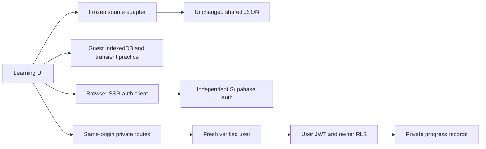

# Implementation Plan: Nordljud CORE

**Branch**: `condition/spec-driven` | **Date**: 2026-10-30 Europe/Helsinki | **Spec**: [approved v0.4.0](spec.md)

**Plan version/status**: 0.1.1 — original v0.1.0 Plan approved; G01/G02 clarification policies approved in the current instruction and recorded below. No implementation is authorized.
**Starting HEAD**: `d140bc9898ef134efff7dc14ef95b2f2158ebc5f`. The approved v0.4.0 spec is existing uncommitted work, bound to its recorded SHA-256; this Plan is not committed at that SHA.
**Approval/provenance**: [Original Plan evidence and v0.4.0 approval](../../evidence/sdd-plan-core-2026-10-30/approval-receipt.json). Original Plan execution stopped after Phase 1. [The later current instruction](../../evidence/sdd-tasks-core-2026-10-30/approval-receipt.json) approves only the G01/G02 documentation clarifications, the 33 supported checklist assessments and Tasks generation. Analyze, implementation, commit, push and service changes remain unauthorized.

## Summary

Build one independent Next.js application for source-faithful A2/B1/B2/C1 learning, complete 456-sense lexicons, two honest practice checks, usable Guest work and optionally authenticated private progress. Keep the unchanged F01–F15 PRIMARY N=15 contract; extension E01–E07/EXT-AC01–07 remains excluded.

Use a source-preserving domain adapter; standard Supabase SSR authentication; same-origin, user-scoped progress routes with RLS; native transactional IndexedDB for the approved Guest state; and Vitest/real-Edge verification. Favorites and manually controlled Studied flags are independent per level-specific sense. Guest completion/practice remains transient. Sign-out applies only to the current browser, as explicitly selected during research.



The two persistence contexts have no import/merge path. No private account records are persisted in the Guest database.

## Technical Context

**Language/Version**: TypeScript 6.0.3; proposed local/CI Node 24.22.2 and npm 11.19.1. Actual current machine: Node 22.15.0/npm 10.9.2; no upgrade or installation ran.

**Primary Dependencies**: Next 16.4.3, React/React-DOM 19.3.1, Supabase JS 2.118.0, SSR 0.12.7. Exact development/test pins and primary metadata are in [research R2](research.md#r2--exact-proposed-dependency-baseline). Native CSS and browser APIs; no additional state manager, ORM, worker or queue.

**Storage**: Frozen shared JSON remains authoritative. Guest: native IndexedDB preference/flag records, plus memory-only mission/practice. Account: three conceptual Postgres owner-state tables accessed with publishable key/user JWT and RLS. No database, schema, project or migration is created by Plan.

**Testing**: Vitest 5.0.5 and Testing Library for domain/client behavior; Playwright 1.64.1 with existing `msedge` for browser/Next/IndexedDB cases; separately authorized real two-account provider/RLS observations. Native private storage mocks cannot establish ownership or live-auth PASS.

**Target Platform**: Responsive web, English interface/Swedish content. Approved observation profile: Edge on Windows at 1280×800 and 360×800 CSS pixels, keyboard-only essential flows; real voice/audio availability recorded later. Future Vercel deployment uses Node 24.x major selection and separately records actual hosted patch versions; deployment is not authorized here.

**Project Type**: One full-stack Next.js web application, independently constructed on the existing Condition B branch. Planned development/test port 3100 avoids implicitly attaching to another local application; a busy port is reported, not killed or reused.

**Performance Goals**: Bound work to a 456-record active level; load a selected level once and reuse its in-memory index. Avoid one network call per vocabulary record. Record actual source-load/search/render latency during later validation. No numerical latency/traffic/uptime SLA was approved, so none is added to the primary score or claimed achieved.

**Constraints**: Exact source identity and missing-field fidelity; four separate levels; two `sticka` meanings; no privileged browser/Git secrets; real server ownership checks; no Guest/account import; safe provider/storage/speech failure behavior. No full offline-launch guarantee, educational certification, browser certification or immediate universal JWT revocation claim.

**Scale/Scope**: 1,824 level-specific source records, four representative missions, two check kinds per mission; at least two legitimate test users for future isolation observations. These are data/test bounds, not an invented production concurrency target. Daily lessons/archive/Undo/reminders/recall and extension media remain excluded.

## Approved G01/G02 Clarifications

[Operation and recovery policies](contracts/operation-recovery.md) clarify existing safe-failure requirements. Automatic source/progress requests have a 15-second client waiting limit, excluding interactive provider consent. A timed-out/cancelled write remains unknown until the same verified owner's current state is reconciled; no automatic write replay or cross-identity retry is permitted. This is not a new primary performance benchmark or proof of server cancellation.

After future authorized schema preparation fails, stop automatic work, preserve data/evidence and report. Normal failed-transaction abort is allowed. Destructive reset/rollback or recovery affecting existing data requires a concrete reviewed plan and separate approval. No database action is performed by adopting this clarification.

The original approved v0.1.0 bytes and open-finding chronology are preserved. These clarifications close CHK024/G01 and CHK025/G02 without changing the original acceptance cases, source inputs, architecture/dependency choices or prior product decisions.

## Constitution Check

Constitution v1.0.0 is ratified, with [original evidence](../../evidence/sdd-ratification-2026-10-30/README.md). The student approved v0.4.0 and authorized Plan in the [new approval record](../../evidence/sdd-plan-core-2026-10-30/approval-receipt.json). Earlier PENDING labels are preserved historical states; this dated approval binds the exact bytes.

PASS below means documentary design alignment, never application acceptance. The before/after gates and stage-execution prose below record the original Plan run; later approval, G01/G02 adoption and Tasks authority are recorded separately above. Pre-research gates were recorded before agents were dispatched; post-design gates re-evaluate the completed artifacts.

| Principle | Before research | After design | Evidence / future limitation |
| --- | --- | --- | --- |
| I — Exact sources/senses | PASS | PASS | Protected blob identities retained; ordinal/source-pair adapter, field-level availability and source tests in data model/quickstart. Application F01–F07 remain NOT TESTED. |
| II — Honest source claims | PASS | PASS | No content repair or new Swedish. D03 rights/teacher review remains unverified and blocks public teaching-data release. |
| III — Ownership | PASS | PASS | Owner-derived identity, least grants, RLS CRUD, revisions, no elevated runtime key; real D02 negative cases remain unavailable/NOT TESTED. |
| IV — Guest/accessibility | PASS | PASS | B/B/B, manual Studied, per-level flags and D01 retained; transactional Guest fallback, keyboard and speech procedures defined. No runtime usability PASS. |
| V — Genuine verification | PASS | PASS | Exact proposed pins, later lockfile, real RED/GREEN procedures, manual limits and separate acceptance ledger defined. No implementation/test run is invented. |
| VI — Independent condition | PASS | PASS | Neutral inputs/current SDD only; no Vibe source/design/tests inspected. Existing bytes and protected refs remain unchanged. |
| VII — Separate evaluation | PASS | PASS | Original PRIMARY N=15 retained. Supplementary FR-020/FR-021 stay separately identified; SECONDARY N=7 is not implemented or blended. |
| VIII — Authorization | PASS | PASS | Genuine installed Plan/setup/research provenance; user-approved sign-out clarification; no hooks/services/code/other stages/commit/push. |

No unjustified Constitution violation exists in the proposed design. Missing operational evidence remains a named prerequisite rather than a waived requirement: D02 for live F09–F12/related login coverage; D03 before public educational publication. Implementation cannot begin until the specification, Plan and acceptance cases have the required human approvals and later quality gates.

## Project Structure

### Documentation — generated by this Plan stage

```text
specs/001-nordljud-core/
├── spec.md                         # Approved v0.4.0; unchanged by Plan
├── checklists/requirements.md      # Existing checklist; unchanged
├── plan.md                         # This proposed implementation plan
├── research.md                     # Completed Phase 0 decisions/sources
├── data-model.md                   # Conceptual entities/invariants, no migrations
├── quickstart.md                   # Future validation/run guide
└── contracts/
    ├── core-http.md                # Source and private progress interfaces
    ├── auth.md                     # PKCE/session/sign-out boundaries
    ├── ui-behavior.md              # Learning/persistence/failure interactions
    └── operation-recovery.md       # Subsequently approved G01/G02 clarification
```

The original Plan run did not generate `tasks.md`. The subsequent Tasks-only authorization and generation are recorded in [new Tasks evidence](../../evidence/sdd-tasks-core-2026-10-30/README.md); neither Plan nor a completed checklist authorizes implementation.

### Source Code — planned only; these files are not created now

```text
src/
├── app/
│   ├── page.tsx                    # Learning entry
│   ├── auth/callback/route.ts      # PKCE code exchange
│   └── api/
│       ├── lexicon/route.ts
│       ├── missions/route.ts
│       ├── session/route.ts
│       └── me/                    # Owner progress and conditional mutations
├── components/                     # Learning, account, feedback, keyboard controls
├── domain/                         # Pure source/sense/check/state rules
├── data/                           # Frozen source adapter/manifest binding
├── persistence/                    # Guest IndexedDB and account API adapters
├── auth/                           # Browser + request-scoped SSR clients
└── proxy.ts                        # Session refresh; not the sole authorization gate
tests/
├── unit/
├── integration/
└── e2e/
supabase/                          # Future independently reviewed schema/policies only
package.json                       # Future exact pins/scripts, not generated now
package-lock.json                  # Future actual resolution, not fabricated now
```

**Structure Decision**: One Next.js application and shared pure domain rules. Preserve existing docs/shared-content/evaluation/evidence rather than scaffolding over the root. Next's [Proxy convention](https://nextjs.org/docs/app/api-reference/file-conventions/proxy) handles refresh; every private Route Handler still verifies identity and authorization. No Vibe layout, SQL, CSS or release template informs this structure.

### Design-to-requirement mapping

| Design surface | Spec / original cases | Future validation |
| --- | --- | --- |
| Source adapter, lexicon, mission shell | FR-001/002/006/007/008/017; F01/F02/F05/F06/F07 | All four levels, all senses, real source examples, separate meanings and counterparts |
| Practice and speech | FR-003/004/005; F03/F04 | Correct/incorrect/revealed/unavailable; actual voice or truthful fallback |
| Guest store and explicit flags | FR-009/018/020/021; F08 + supplementary checks | Transaction completion, refresh, per-level/manual flags, no import, storage failure |
| Auth and private persistence | FR-010/011/012/013/018; F09–F12 | Hosted real providers, local sign-out, positive ownership and negative cross-account CRUD |
| Essential UI and failures | FR-014/015; F13/F14 | Both D01 viewports, keyboard, actionable non-disclosing errors, delivered secret review |
| Evidence/reproduction | FR-016/019; F15 | Exact tested SHA/versions/commands/outcomes, original denominator, genuine unavailable results |

Detailed contracts are linked above; [quickstart](quickstart.md) keeps original case evidence separate from supplementary design checks.

## Complexity Tracking

No Constitution exception is requested. The single application and three small account-state tables are sufficient; no alternate service, background scheduler, global state framework, media pipeline or extension subsystem is introduced. Future implementation must not use this section to waive ownership, source fidelity, fixed acceptance cases or human gates.

## Execution boundary and next review

Phase 0 and Phase 1 are documentary design work. No package/lockfile/app/test/migration implementation, provider/project configuration, browser acceptance, deployment or billing was run. The installed setup-plan script ran once and copied the protected resolved template; the template itself is unchanged. Pre/post extension-hook checks found no hooks file.

Review this Plan, contracts and validation guide. Under the approved project sequence, the next stage is the separate specification/plan quality **Checklist**, followed later by Tasks/Analyze/Implement/Converge with their own authorization; this Plan does not start any of them.
